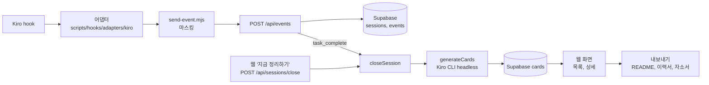

# CV 에이전트 — 바이브코딩한 과정을 그대로 포트폴리오로

Kiro로 개발하는 동안 겪은 문제와 해결 과정을 자동으로 모아 STAR 트러블슈팅 카드로 정리하고, README·이력서·자소서 초안으로 내보내는 서비스입니다. (KIROTHON 2026, 가칭)

## 데모 영상

[영상 링크 자리]

## 문제

- 바이브코딩은 결과물이 빨리 나오지만, 내가 어떤 판단을 했고 무엇을 해결했는지가 남지 않습니다.
- 그래서 면접에서 "어떤 문제를 해결했나요?"에 구체적으로 답하기 어렵습니다.
- 기존 성과 기록 도구는 GitHub 커밋만 봐서, AI와 문제를 푼 과정은 잡지 못합니다.

## 해결: 동작 흐름

1. **자동 수집**: Kiro hook이 프롬프트, 셸 실행 결과(테스트 실패와 통과 포함), spec 태스크 시작·완료를 서버로 보냅니다. 따로 기록할 필요가 없습니다.
2. **세션 닫힘**: spec 태스크가 끝나면 그동안 쌓인 이벤트가 한 세션으로 닫힙니다. spec 없이 작업했다면 웹 화면의 "지금 정리하기" 버튼을 누릅니다.
3. **STAR 카드 생성**: 세션의 로그를 LLM에 보내 트러블슈팅을 상황·과제·행동·결과 카드로 만듭니다. 세션당 0~3개입니다.
4. **포트폴리오 내보내기**: 카드를 골라 GitHub README 트러블슈팅 섹션, 이력서 한 줄, 자소서 초안(문항과 글자 수 입력)으로 바꿔 복사합니다.

## 구조



## Kiro 활용

### 개발 과정

- **steering으로 팀 기준 공유**: 4인 팀이 같은 기준으로 Kiro를 쓰도록 제품, 기술 스택, 폴더 구조를 문서로 고정했습니다.
  - [product.md](.kiro/steering/product.md): 문제, 대상 사용자, 핵심 기능, 데모 흐름
  - [tech.md](.kiro/steering/tech.md): 사용 기술과 환경 변수
  - [structure.md](.kiro/steering/structure.md): 폴더 구조, 담당, 브랜치 규칙
  - [AGENTS.md](AGENTS.md): 모든 에이전트가 따르는 명령과 작업 규칙
- **spec으로 담당별 작업 분배**: 요구사항, 설계, 태스크를 spec으로 쓰고, 태스크마다 담당(be-1, be-2, fe, PM)을 붙여 각자 자기 담당 태스크만 실행하도록 했습니다.
  - [requirements.md](.kiro/specs/mvp/requirements.md)
  - [design.md](.kiro/specs/mvp/design.md)
  - [tasks.md](.kiro/specs/mvp/tasks.md)

### 제품 안

- **Kiro hook으로 개발 과정 수집**: `UserPromptSubmit`, `PostToolUse`, `PreTaskExec`, `PostTaskExec`, `Stop` hook이 Kiro가 넘기는 입력을 공통 이벤트 형식으로 바꿔 보냅니다.
  - [hooks.json](scripts/hooks/adapters/kiro/hooks.json): 설치되는 hook 설정
  - [adapter.mjs](scripts/hooks/adapters/kiro/adapter.mjs): hook 입력을 이벤트로 변환
  - [NOTES.md](scripts/hooks/adapters/kiro/NOTES.md): Kiro에서 직접 확인한 hook 입력 형식
- **Kiro CLI headless 모드로 카드 생성**: `kiro-cli chat --no-interactive`를 서버에서 실행하고 프롬프트를 표준입력으로 넘겨 카드를 받습니다. 자소서 초안도 같은 함수로 만듭니다.
  - [generate-cards.ts](lib/services/generate-cards.ts)의 `callLlm`

## 제품 원칙

- 근거 없는 수치와 결과는 지어내지 않고 "확인 필요"로 표시합니다. 사용자가 상세 화면에서 직접 채웁니다.
- 비밀 정보(키, 토큰, `.env` 내용)와 사용자 홈 폴더 경로의 이름은 서버로 보내기 전에 마스킹합니다. LLM에 보내기 직전에도 한 번 더 마스킹합니다.
- 사용자가 최종 확인합니다. AI는 초안만 만듭니다. 모든 카드는 원본 로그를 근거로 연결합니다.

## 실행 방법

### 요구 사항

- Node.js
- Supabase 프로젝트
- Kiro IDE
- kiro-cli (설치 후 `kiro-cli login`). 서버를 돌리는 PC에 있어야 하므로 **로컬 실행 전용**입니다.
- Windows에서는 `install.sh`를 Git Bash로 실행합니다.

### 1. 환경 변수

`.env.example`을 복사해 `.env.local`을 만들고 값을 채웁니다. 값은 저장소에 넣지 않습니다.

| 이름 | 용도 |
|---|---|
| `NEXT_PUBLIC_SUPABASE_URL` | Supabase 프로젝트 주소 |
| `NEXT_PUBLIC_SUPABASE_ANON_KEY` | Supabase 공개 키 |
| `KIRO_CLI_PATH` (선택) | kiro-cli 실행 파일 경로. 기본은 `kiro-cli` |
| `KIRO_MODEL` (선택) | 카드 생성에 쓸 모델. 기본값은 코드에 있음 |
| `LLM_PROVIDER`, `GEMINI_API_KEY` | Gemini 대비책용 이름. **현재 코드는 Kiro CLI만 호출합니다.** |

### 2. DB

Supabase SQL Editor에서 아래 순서로 파일 전체를 실행합니다.

1. [db/be-1/events.sql](db/be-1/events.sql): `sessions`, `events`
2. [db/be-2/cards.sql](db/be-2/cards.sql): `cards` (1번을 먼저 실행해야 합니다)

### 3. 서버 실행

```bash
npm install
npm run dev
```

http://localhost:3000 에서 확인합니다.

### 4. 대상 저장소에 hook 설치

수집할 저장소 폴더로 이동한 뒤 이 저장소의 스크립트를 실행합니다.

```bash
cd <수집할 저장소>
bash <이 저장소 경로>/scripts/install.sh
```

서버 주소(기본 `http://localhost:3000`)와 프로젝트 이름을 물어봅니다. 스크립트가 복사하는 것은 다음과 같습니다.

- `scripts/hooks/send-event.mjs`, `scripts/hooks/adapters/kiro/`
- `.kiro/hooks/cv-agent.json`
- `.cvagent/config.json` (`.gitignore`에도 추가됩니다)

설치 후 Kiro에서 다음을 합니다. 하지 않으면 hook이 실행되지 않습니다.

1. 수집할 저장소 폴더를 직접 열고 워크스페이스를 **Trust** 합니다.
2. **Reload Window** 를 합니다.
3. **새 채팅**을 엽니다.

## 데모 시나리오

이 저장소의 `demo` 브랜치가 시연용 프로젝트입니다. 일정 관리 기능을 만들다가 시간대 버그를 만나는 상황을 재현하며, 테스트 일부가 의도적으로 실패합니다. 제품 코드와는 이력이 별개이니 다른 폴더에 `demo` 브랜치만 받습니다.

```bash
git clone -b demo --single-branch https://github.com/soyoun040-ds/kirothon.git demo
cd demo
npm install
```

시연 흐름:

1. `demo` 폴더에서 `install.sh`로 hook을 설치합니다. (위 4번)
2. spec 태스크 하나를 실행합니다. 테스트가 실패했다가 수정되어 통과합니다.
3. 태스크가 끝나면 세션이 닫히고 카드가 만들어집니다. 자동 경로가 안 되면 "지금 정리하기"를 누릅니다.
4. 웹 화면에서 카드를 확인하고, "확인 필요" 칸을 채웁니다.
5. 내보내기에서 README 섹션과 자소서 초안을 만듭니다.

Kiro IDE 없이 서버와 카드 생성만 확인하려면, `npm run dev`를 켠 상태에서 테스트 이벤트를 보냅니다. 실제 파이프라인(저장, 세션 닫기, 카드 생성)을 그대로 탑니다.

```bash
node seed/send-test-events.mjs            # spec 태스크 완료로 자동 닫기
node seed/send-test-events.mjs --manual   # "지금 정리하기" 경로로 닫기
```

## 확장 계획

이번 범위에서는 Kiro 어댑터만 구현했습니다.

- **Claude Code, Cursor 어댑터**: 서버는 도구와 무관한 `POST /api/events` 하나로 이벤트를 받고, 도구별 차이는 `scripts/hooks/adapters/<도구이름>/`이 흡수합니다. 어댑터를 폴더 하나씩 추가하면 됩니다.
- **MCP 연동**: hook이 없는 AI 앱에서 사용자가 "기록해 줘"라고 하면 대화 원문 인용을 붙여 서버로 보내는 방식입니다. 세션 닫기와 카드 생성 함수가 수집 경로와 분리되어 있어 다른 입구에서도 같은 함수를 쓸 수 있습니다.

## 팀

| 역할 | 이름 |
|---|---|
| PM | (이름) |
| FE | (이름) |
| BE-1 | (이름) |
| BE-2 | (이름) |
